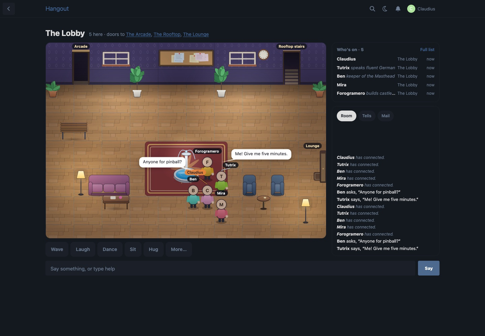
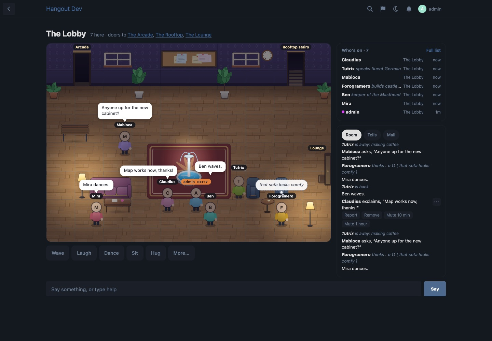

# Hangout

A light 2D talker world inside your Flarum forum: a modern web rewrite of **The Chatting Zone (TCZ)**, the 1990s telnet talker. Members walk between rooms and chat in speech bubbles, with TCZ's own commands, feelings, ranks and who list. No telnet, no game engine: one canvas, one small art atlas, the forum's own members, groups and permissions.



## What members get

- **Rooms to walk around.** Click or tap the floor (or use the arrow keys) and you walk there; walk through a door to go to the next room. Four rooms out of the box: the Lobby, the Arcade, the Lounge and the Rooftop, with lighting that follows the forum's clock (the Rooftop's sky goes from sunny to starry).
- **Talking, TCZ style.** `say`, `emote` (`:waves`), `think` (`+hmm`), `ask`, and every TCZ feeling command (`wave`, `ack`, `aha`, `baa`, `puke`, `moose`, `hug Ben = tightly`…), with bubbles over your head and a room log.
- **Long distance.** `page` and `tell` one person or several at once (`tell ben,tutrix = hi`), `remote`, `reply`, and `recall` for the last eight sent to you, in a Tells tab.
- **Who's on.** TCZ's who list with prefix, name, suffix and title, the room and idle times; connect and disconnect lines with your own messages; `afk` with a reason; people doze (zZ) when idle.
- **Your card.** Click anyone for their card: rank, title, mood (`feeling chirpy`), description (`describe`), time here, and their latest post you're allowed to see.
- **Ranks.** TCZ's ranks tied to Flarum groups, with names and colours the admin can change: the Wizard ladder (Apprentice Wizard, Wizard, Elder Wizard), the Druid ladder (Apprentice Druid, Druid, Elder Druid), the Deity, and Retired, Experienced Builder, Assistant, Builder, Mortal and Moron.
- **Channels, friends and mail.** Chat channels that follow you between rooms, each with its own tab (`-gaming hi`); friends are pinged when they connect and enemies are ignored; `mail` reaches someone who isn't on as a Flarum notification; `shout` reaches every room and `yell` every room in your area, both rate-limited; aliases for your own short commands; TCZ's partners.
- **The board.** TCZ's BBS as a notice board in the Lobby.
- **A command bar** that takes the classic commands and shorthand (`"` say, `:` pose, `+` think, `>` tell, `<` remote), next to buttons for the common feelings.
- **Phones.** The room on top with a camera that follows you, feelings, the log, and the command bar above the keyboard.

## Keeping it civil



- **Report.** Every message has a ⋯ beside it. Report raises a Flarum flag, so it lands in the moderators' usual Flags list (needs **flarum/flags**). The report is a post in a hidden "Hangout reports" discussion that only staff can see, quoting the message as plain text.
- **Remove.** Druids and up (and the Deity) take a message out of everyone's log and bubble, for good (`remove`, or the ⋯ menu).
- **Mute.** Druids and up stop someone talking, paging, shouting, mailing and posting on the board for a while: `mute ben 30`, `unmute ben`, or Mute 10 min / 1 hour in the ⋯ menu. Staff can only act on people below their own rank.
- **Suspended members** (flarum/suspend) can't enter, and suspending someone puts them out at once.
- Talking, paging, shouting, yelling, channels, mail, the board and reports all have rate limits.

## How it works

- Everything said and done is one event log, read by id. With **flarum/realtime** installed each event is pushed to the people who may see it at once; without it (shared hosting), the page asks every 1.8 s for "anything after event N?", which an up-to-date browser gets from the cache without touching the database.
- forum.js only adds the route and the nav link (under 2 KB gzipped). The world is one lazy chunk (about 21 KB gzipped) and one WebP art atlas (about 120 KB). Nothing is added to discussion, post or user lists: Hangout runs no queries outside its own pages.
- Tested on MySQL and PostgreSQL, with table prefixes.

## Install

```bash
composer require ernestdefoe/hangout
php flarum migrate
php flarum cache:clear
```

Then enable Hangout in the admin, give groups the Hangout permissions (members can enter, talk and shout by default; guests can't look in unless you let them), and pick a group for each rank (out of the box the Deity is Admins and the Druid is Mods). Optional: **flarum/realtime** for instant delivery, **flarum/flags** for reports, **flarum/suspend**.

To update:

```bash
composer update ernestdefoe/hangout
php flarum migrate
php flarum cache:clear
```

## Credits

Hangout ports the behaviour and text of **The Chatting Zone (TCZ)** by J.P. Boggis and its contributors. TCZ grew from UglyMUG and from TinyMUD, by the TinyMUD authors; their notices are in COPYRIGHT in full. TCZ's source: https://github.com/smcvey/tcz.

## Licence

GPL-2.0-or-later, like TCZ. See LICENSE and COPYRIGHT.

☕ [Buy me a coffee](https://buymeacoffee.com/ernestdefoe)
